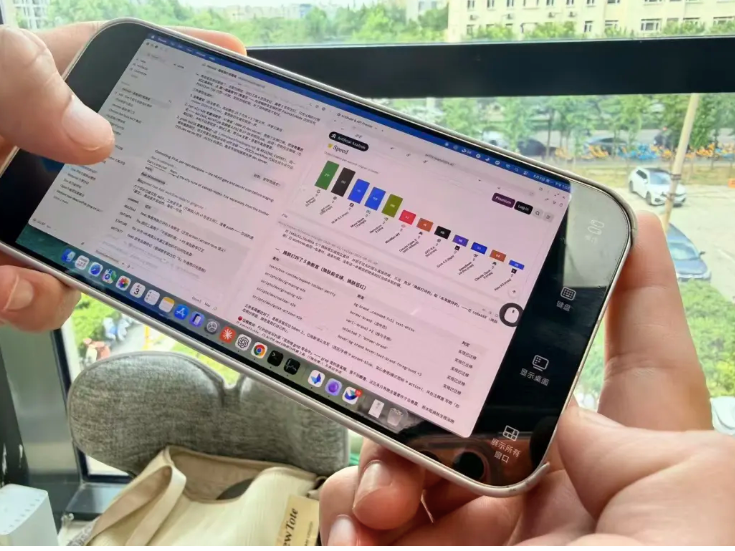
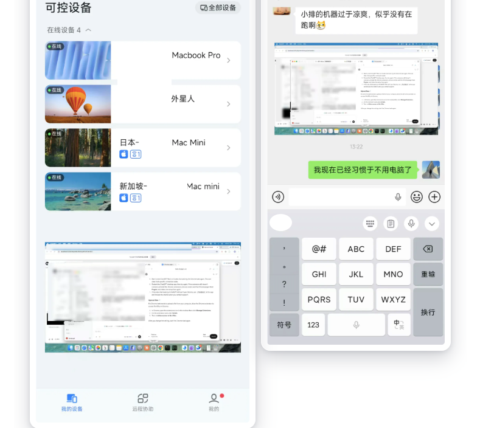

向各位朋友们汇报一个我工作习惯上的重要改变：最近，我已经习惯不直接使用电脑了。

无论在哪儿，我都只需要一台手机（或者iPad），同时操作4台电脑上的Agent （Claude Code和Codex）

「用手机控制电脑」本来不是什么新鲜事，而且字太小也不容易看清楚。
为啥最近我切换为了这个工作模式呢？

因为，有两个最近三个月才刚刚产生的巨变：

1. AI越来越强，我们不再需要“聊天式”“一问一答式”的vibe coding了。
一个任务布置下去，一线的AI Agent可以一次性执行很久。
这就意味着，我们完全没必要长时间盯着屏幕，那完全是浪费时间。

2. 语音输入法越来越越强。这就意味着，电脑键盘也没啥用了。

下图是我的4个真· 数字员工，他们从物理上分布在4个不同的地方。

我甚至可以打开小窗权限，手机看视频的时候，也顺便盯两眼AI员工的工作情况。

也许你会问，
字那么小，看不清楚怎么办？

不难，当AI交付完成任务、我需要细看、验收或者做决策的时候，放大即可。

那么，需要打字的时候怎么办？
更简单——语音输入。

这样一来，我就极大地释放了我自己的时间和精力。
该玩就玩，该看书就看书。

99%的时间不看电脑、不看手机、不看屏幕。
