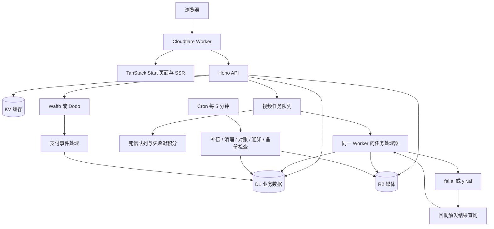

# ShrimpReel 项目调研报告

调研日期：2026-10-23  
项目地址：https://github.com/qianshuixia/shrimpreel  
代码基线：`main`，提交 `9a945aa758c5cae1079b9ad12172b1a2f1b32617`（提交时间：2026-10-22，UTC+8）。

## 1. 结论

**ShrimpReel 是一个围绕“上传一张照片，套用热门视频模板生成短视频”的 SaaS 建站模板。它最有价值的部分是收费、积分、异步生成、运营后台与多站维护能力，而非自研视频模型。适合作为独立开发者的产品起点，但当前不能视为已经生产验证的成品。**

核心判断：

- **产品定位明确**：一个热门关键词对应一个独立站，通过演示视频、教程和搜索流量，引导用户购买积分或订阅，再调用外部模型生成视频。
- **业务闭环较完整**：不仅有登录和付款，还包括退款回收积分、失败退积分、主动对账、订阅、邀请奖励、兑换码、举报下架、数据保留和后台运营。
- **复用方式明确**：站点差异集中在配置、文案和素材；共享代码通过 Git upstream 合并更新。它是多仓库、多部署的模板体系，不是现成的多租户平台。
- **最大不确定性在真实交付**：作者说明 fal.ai、yir.ai 真实视频生成尚未实测，Cloudflare 线上部署及多个外部服务的真实链路也未验证。
- **采用建议**：先完成一个关键词、一个模型、一个支付商的小规模真实闭环，再决定是否扩展到多个站点。模型效果、实际成本和用户付费意愿应早于批量铺站验证。

依据：[项目说明](https://github.com/qianshuixia/shrimpreel)、[ROADMAP](https://github.com/qianshuixia/shrimpreel/blob/9a945aa758c5cae1079b9ad12172b1a2f1b32617/ROADMAP.md)、[站点配置](https://github.com/qianshuixia/shrimpreel/blob/9a945aa758c5cae1079b9ad12172b1a2f1b32617/src/config/site.ts)。

## 2. 调研范围与证据边界

本次读取了仓库说明、路线图、依赖与部署配置、数据库迁移、Worker 入口、支付/积分代码、生成任务及服务商适配、备份实现、CI 和测试目录，并结合 Cloudflare 官方文档核查 D1 事务和队列投递语义。

本文区分三种证据：

| 类型 | 含义 |
| --- | --- |
| 源码核查 | 在当前提交中可以看到对应实现或配置，不代表真实服务运行成功 |
| 作者自述 | ROADMAP 或文档记录的测试结果；部分测试工件只在作者本机，没有公开入库 |
| 分析判断 | 根据源码推导出的适用性、风险和采用建议，未经生产压测或故障注入验证 |

**本次未安装项目依赖、未启动应用、未运行其单元测试或浏览器测试，也未调用付费服务或部署资源。** 以下通过数量属于作者报告，不是本次复测结果。本次不是全面安全审计，也没有验证真实收入、用户规模或获客效果。

仓库提供 MIT 许可证；源码复用时应保留其要求的版权和许可声明。实际采用前还需要分别核对模型、第三方服务和素材的使用条件。[LICENSE](https://github.com/qianshuixia/shrimpreel/blob/9a945aa758c5cae1079b9ad12172b1a2f1b32617/LICENSE)

## 3. 产品形态与用户路径

### 3.1 核心体验

典型路径是：

1. 用户从搜索、社交内容或广告进入某个热点主题站。
2. 查看原始模板、生成效果、教程和价格。
3. 使用 Google 登录，上传照片，选择视频时长。
4. 积分不足时购买积分包或订阅。
5. 服务端扣积分并创建生成任务，队列调用模型服务。
6. 用户在个人中心查看状态，完成后下载或主动开启分享；失败时系统退积分。

默认示例品牌为 **Neon Shuffle AI**，域名为 `example.com`，展示素材包含占位内容。它们不构成真实产品效果或市场验证证据。

### 3.2 已实现的功能范围

| 模块 | 当前仓库能力 | 采用时的关注点 |
| --- | --- | --- |
| 登录与账户 | Google OAuth、One Tap、个人中心、注销、数据导出 | 真实 OAuth 回调待验证；本地开发登录不能作为上线验收替代 |
| 视频生成 | 上传、时长选择、异步任务、状态查询、失败退款 | 实际效果由外部模型和模板素材决定 |
| 收费 | Waffo / Dodo、积分包、月付/年付订阅、退款、主动查单 | 默认开发配置为 mock；真实续费、争议等覆盖不完整 |
| 积分 | 批次、到期、流水、扣减分配、兑换码、邀请奖励 | 属于资金相关核心模块，二次开发应保持事务和幂等约束 |
| 管理后台 | 用户、订单、生成记录、邮件、举报、审计、报表、运营设置 | 后台为中文；精细 RBAC 仍在待办中 |
| 增长 | 首末次来源归因、转化漏斗、可选 GA4、主动分享 | 分享页为 noindex，主要服务传播，不直接充当 SEO 内容页 |
| 内容与 SEO | 中英文 SSR、canonical、hreflang、JSON-LD、sitemap、指南集合 | 生成技术结构不等于获得排名；新站需要独立内容和素材 |
| 运营保障 | 邮件发件箱、重试、告警、每日备份、付款通知、维护模式 | 多项外部发送和线上触发尚待真实验证 |

功能范围可交叉查看：[功能说明](https://github.com/qianshuixia/shrimpreel/blob/9a945aa758c5cae1079b9ad12172b1a2f1b32617/docs/SAAS_VIDEO_FEATURES.md)、[测试覆盖目录](https://github.com/qianshuixia/shrimpreel/blob/9a945aa758c5cae1079b9ad12172b1a2f1b32617/tests/e2e/CATALOG.md)。

## 4. 技术架构

### 4.1 技术栈与职责

| 层次 | 技术 | 职责 |
| --- | --- | --- |
| 前端与 SSR | React 19、TanStack Start / Router、Tailwind CSS 4、Vite | 页面、路由、服务端渲染、双语内容 |
| API | Hono、TypeScript | 身份、订单、生成、后台、媒体和 SEO 接口 |
| 运行平台 | Cloudflare Workers | 同一入口处理 HTTP、Queue 和 Scheduled 事件 |
| 业务数据 | D1 / SQLite | 用户、订单、积分、生成任务、订阅、审计等 |
| 文件 | R2 | 模板视频、上传照片、生成结果、备份 |
| 缓存及辅助状态 | KV | 运营设置缓存、备份尝试次数等 |
| 异步任务 | Queues、死信队列、Cron | 提交/查询生成、失败处理、定期补偿 |
| 外部服务 | fal.ai / yir.ai、Waffo / Dodo、Google、审核及邮件服务 | 模型推理、收款、登录、审核、通知 |
| 验证工具 | Vitest、Playwright、GitHub Actions、doctor、SEO checker | 逻辑测试、流程测试、构建与部署前检查 |

版本以调研提交的 [package.json](https://github.com/qianshuixia/shrimpreel/blob/9a945aa758c5cae1079b9ad12172b1a2f1b32617/package.json) 为准。CI 使用 Node 24；项目要求 npm ≥ 11.19.0，并说明旧版 npm 可能改写锁文件导致 CI 安装失败。



架构图省略了登录、审核和邮件的细部链路。视频队列由同一 Worker 消费，不是另一台常驻渲染服务器；模型推理由外部服务完成。依据：[Worker 入口](https://github.com/qianshuixia/shrimpreel/blob/9a945aa758c5cae1079b9ad12172b1a2f1b32617/src/server.ts)、[部署配置](https://github.com/qianshuixia/shrimpreel/blob/9a945aa758c5cae1079b9ad12172b1a2f1b32617/wrangler.jsonc)。

### 4.2 支付与积分：最值得借鉴的设计

项目把积分余额、批次余额和流水分开记录，通过统一函数生成 SQL，再与业务状态变更放入同一个 `db.batch`。业务对象决定幂等键，例如 `order:<id>`、`generation:<id>` 和 `generation_refund:<id>`。

关键机制包括：

- 付款回调、主动查单统一进入 `processPaymentEvent`，减少多条入账路径产生分歧。
- 入账核对商品、币种与金额；不匹配或找不到订单时记录异常状态，供后台和告警处理。
- 扣积分优先消耗最早到期的批次，记录扣减分配；生成失败按分配原路退回。
- 用 SQL 条件、唯一键和 `credit_guard` 的 CHECK 约束阻止不满足条件的批处理完成。
- 退款回收积分与普通生成失败退积分采用不同业务规则。
- 年付订阅一次收取年度费用，但按月发放积分，需要定时任务持续维护。

D1 官方说明 `batch()` 的语句按顺序在事务中执行，失败时回滚整个序列，这与项目的设计基础一致；仍需在线上验证迁移和并发行为。[D1 batch 文档](https://developers.cloudflare.com/d1/worker-api/d1-database/)

对应代码：[credits.ts](https://github.com/qianshuixia/shrimpreel/blob/9a945aa758c5cae1079b9ad12172b1a2f1b32617/src/server/credits.ts)、[orders.ts](https://github.com/qianshuixia/shrimpreel/blob/9a945aa758c5cae1079b9ad12172b1a2f1b32617/src/server/orders.ts)、[支付接入说明](https://github.com/qianshuixia/shrimpreel/blob/9a945aa758c5cae1079b9ad12172b1a2f1b32617/docs/payments.md)、[订阅说明](https://github.com/qianshuixia/shrimpreel/blob/9a945aa758c5cae1079b9ad12172b1a2f1b32617/docs/subscriptions.md)。

### 4.3 视频任务：有补偿设计，但仍存在外部提交的不确定窗口

任务提交前使用条件更新抢占 `queued` 状态，防止重复消息并发提交。服务商回调只提示系统重新查询，最终结果用服务端密钥向服务商获取。生成结果转存 R2；失败、超时和死信有退积分路径；Cron 补偿长时间没有更新的任务。

Cloudflare Queues 默认是至少一次投递，可能重复发送，所以数据库状态检查与幂等处理是必要的。[Queues 投递保证](https://developers.cloudflare.com/queues/reference/delivery-guarantees/)

**静态分析发现一个需要优先验证的场景：外部提交已成功，但本地未能可靠记录结果。** fal 适配器没有传递与任务 ID 对应的服务商幂等键；`submitGeneration` 在可重试异常时将任务恢复为 `queued`，Cron 也会重新提交未拿到请求 ID 的任务。因此，服务商已接单但响应丢失、D1 写入失败，或后续轮询入队异常时，存在再次提交和额外计费的可能。数据库抢占只能控制本地竞争，不能让外部 API 与本地存储共同构成事务。

yir 适配器显式传递 `Idempotency-Key: generationId`，提供了对应的请求去重设计，但真实效果仍需服务商实测。以上是代码推导的故障风险，**本次没有复现重复收费，也未核实 fal 是否提供其他可用的幂等或恢复能力**。

建议在真实验证阶段注入“接单后断网”“记录请求 ID 失败”“轮询入队失败”等故障，核对服务商请求数、最终成片数和账单，而不只检查用户积分是否正确。

对应代码：[jobs.ts](https://github.com/qianshuixia/shrimpreel/blob/9a945aa758c5cae1079b9ad12172b1a2f1b32617/src/server/jobs.ts)、[fal.ts](https://github.com/qianshuixia/shrimpreel/blob/9a945aa758c5cae1079b9ad12172b1a2f1b32617/src/server/video/fal.ts)、[yir.ts](https://github.com/qianshuixia/shrimpreel/blob/9a945aa758c5cae1079b9ad12172b1a2f1b32617/src/server/video/yir.ts)。

## 5. 模型选择与商业成本

### 5.1 两条生成路径并不完全等价

| 服务商 | 仓库默认模型/方式 | 主要差异 | 验证状态 |
| --- | --- | --- | --- |
| fal.ai | `fal-ai/wan/v2.2-14b/animate/replace`，默认 480p | 用照片与源视频做角色替换 | 作者明确尚未使用真实 FAL_KEY 生成 |
| yir.ai | `klingai/kling-2.6`，reference 模式，默认 720p | 照片 + 参考视频驱动动作，走网关路由 | 作者明确未用真实 key；效果和单价待验证 |
| mock | 复制模板视频 | 用于流程开发，不验证人物一致性和生成效果 | 本地测试路径 |

**切换服务商不是只替换一个价格参数**：人物保真、动作跟随、时长、分辨率、排队时间和失败模式都可能不同。[模型配置](https://github.com/qianshuixia/shrimpreel/blob/9a945aa758c5cae1079b9ad12172b1a2f1b32617/src/config/site.ts)、[模型验证说明](https://github.com/qianshuixia/shrimpreel/blob/9a945aa758c5cae1079b9ad12172b1a2f1b32617/ROADMAP.md)

### 5.2 默认定价与估算

以下全部是**仓库配置快照及其公式计算，不是服务商当前报价、实际账单或利润预测**。

| 项目 | 默认值 |
| --- | --- |
| 视频档位 | 6 / 12 / 18 秒，消耗 6 / 12 / 18 积分 |
| 一次性积分包 | 20 积分 $9.90；60 积分 $19.90；100 积分 $29.90 |
| 月订阅 | $14.90，每月 60 积分 |
| 年订阅 | $149.00，每月 60 积分，年度合计 720 积分 |
| 注册赠送 | 默认 0 积分 |
| 邀请奖励 | 默认首笔付款奖励邀请人 10 积分 |

fal 成本函数为：`源视频秒数 × sourceFps ÷ 16 × costCentsPerVideoSecond`。代入仓库的 24 fps 与 4 美分，6 / 12 / 18 秒的模型成本估算分别为 **$0.36 / $0.72 / $1.08**。yir 的默认估算是每秒 7 美分，对应 **$0.42 / $0.84 / $1.26**。

以 100 积分 $29.90 的积分包按比例分摊，6 积分对应约 $1.79 收入。这个数与 $0.36 的差额仅是理论上的模型成本前后差，不能作为实际毛利率。还需要计入：

- 支付手续费、退款、争议损失和税费结算口径。
- 失败但服务商仍收费的请求、重复提交、用户要求重做。
- 赠送和邀请积分，以及订阅用户的使用率。
- Cloudflare 运行、存储、队列、邮件、审核和后处理费用。
- 获客、素材制作、客服、内容维护及多站运维成本。

后台 fal 成本来自配置估算；yir 在结果账单已结算时读取实际金额，否则回退到估算。建议建立“每次尝试成本、每条成功视频成本、每个付费用户贡献”三层指标，并与服务商账单核对。[成本实现 fal](https://github.com/qianshuixia/shrimpreel/blob/9a945aa758c5cae1079b9ad12172b1a2f1b32617/src/server/video/fal.ts)、[成本实现 yir](https://github.com/qianshuixia/shrimpreel/blob/9a945aa758c5cae1079b9ad12172b1a2f1b32617/src/server/video/yir.ts)

## 6. 工程成熟度与主要限制

### 6.1 已有验证体系

作者在 2026-10-22 的 ROADMAP 中报告：214 个单元测试、64 个 e2e 用例通过，typecheck 和 build 通过，SEO 检查 20 个页面无 error。仓库包含相应测试及 CI 配置，但这些数字本次未复测。

支付商已做过部分真实 sandbox 联调，其中 Dodo 订阅取消操作受测试密钥权限限制；真实续费、扣款失败、争议和 live 模式仍有缺口。普通 e2e 主要依赖 mock；浏览器覆盖主要是 Desktop Chrome。

这说明项目在本地一致性和流程回归方面有投入，不能由此推断真实视频质量、生产稳定性或移动端体验已经达标。[ROADMAP](https://github.com/qianshuixia/shrimpreel/blob/9a945aa758c5cae1079b9ad12172b1a2f1b32617/ROADMAP.md)、[测试目录](https://github.com/qianshuixia/shrimpreel/blob/9a945aa758c5cae1079b9ad12172b1a2f1b32617/tests/e2e/CATALOG.md)、[CI 配置](https://github.com/qianshuixia/shrimpreel/blob/9a945aa758c5cae1079b9ad12172b1a2f1b32617/.github/workflows/ci.yml)

### 6.2 应重点处理的风险

| 优先级 | 风险或限制 | 影响与建议 |
| --- | --- | --- |
| P0 | 真实视频生成未验证 | 先用多类真实授权素材验证身份保真、动作、耗时、失败率和账单 |
| P0 | 生产环境链路未验证 | 验证真实 D1 迁移、Queues 重试/死信、Cron、R2、域名、Google 登录和支付 |
| P0 | 外部提交有不确定窗口 | 按第 4.3 节做故障注入，确定去重与人工对账策略 |
| P0 | 默认部署配置为 development + mock | 使用项目 `npm run deploy` 的 doctor 门禁；避免绕过检查直接部署 |
| P1 | CSP 仅 Report-Only | 现在是报告违规，不会按 CSP 阻止违规脚本；观察后再评估强制执行 |
| P1 | 管理员名单修改不自动降级 | 移除邮箱后还需后台取消角色；需要明确离职或交接流程 |
| P1 | 后处理未接入主流程 | 不应把播放器角标等同于视频文件已经烧录水印或写入 C2PA |
| P1 | 备份在内存中构造整库 SQL | 数据增长后有内存及执行压力；需要恢复演练，再考虑分段导出 |
| P1 | 移动端、Safari、真实社交预览覆盖不足 | 该产品面向短视频受众，上线前应验证上传、下载与分享 |
| P1 | 生产审核、邮件与 Turnstile 未实测 | 除 API 返回成功，还需核查真实拦截、失败行为与邮件投递 |
| P2 | 多仓库维护随站点数增长 | 保持共享层一致，避免每站修改支付/积分核心；建立升级记录 |

P0/P1/P2 是本报告针对采用过程的排序，不是项目官方漏洞评级。风险依据：[已知问题与未验证清单](https://github.com/qianshuixia/shrimpreel/blob/9a945aa758c5cae1079b9ad12172b1a2f1b32617/ROADMAP.md)、[备份代码](https://github.com/qianshuixia/shrimpreel/blob/9a945aa758c5cae1079b9ad12172b1a2f1b32617/src/server/backup.ts)、[Worker 入口](https://github.com/qianshuixia/shrimpreel/blob/9a945aa758c5cae1079b9ad12172b1a2f1b32617/src/server.ts)。大对象处理宜采用流式方式，避免无界缓冲，这也符合 [Workers 官方最佳实践](https://developers.cloudflare.com/workers/best-practices/workers-best-practices/)。

### 6.3 安全与内容治理的边界

代码已包含照片签名访问、上传限制、审核适配、举报下架、原图哈希封禁、默认照片 7 天/成片 30 天保留、用户主动分享和数据导出等能力。它们是产品机制，不能据此认定站点自动满足某个地区的全部法律要求。

需要特别区分：

- `containers/postprocess/` 中的 ffmpeg 水印和 C2PA 属于作者报告的本地技术验证，Docker 镜像未构建验证，Worker 尚未接入。
- 第三方模型会接收用户照片和参考视频；yir 的上游渠道还与路由配置有关，需要核查实际数据流向。
- 支付回跳中的邮箱在渲染前被移除，但作者说明第一次请求的 URL 仍可能出现在 Workers 日志。
- 自动清理和举报处理需要真实 Cron、存储规则及运营响应配合，代码存在不等于所有删除承诺已经端到端验证。

依据：[ROADMAP](https://github.com/qianshuixia/shrimpreel/blob/9a945aa758c5cae1079b9ad12172b1a2f1b32617/ROADMAP.md)、[后处理目录](https://github.com/qianshuixia/shrimpreel/tree/9a945aa758c5cae1079b9ad12172b1a2f1b32617/containers/postprocess)、[站点配置](https://github.com/qianshuixia/shrimpreel/blob/9a945aa758c5cae1079b9ad12172b1a2f1b32617/src/config/site.ts)。

## 7. 部署与多站复用方式

### 7.1 本地启动路径

以下来自项目说明，本次未执行：

```bash
npm install
cp .dev.vars.example .dev.vars
# 在 .dev.vars 中设置 SESSION_SECRET
npm run seed:local
npm run dev -- --host 127.0.0.1
```

本地支付、视频和审核默认走 mock。dev 登录及 mock 入口要求本机直连，文档明确不应把开发服务直接暴露到公网。依赖安装应匹配项目要求的 npm 版本。[中文使用说明](https://github.com/qianshuixia/shrimpreel/blob/9a945aa758c5cae1079b9ad12172b1a2f1b32617/README.zh-CN.md)

### 7.2 生产落地需要准备什么

生产站需要独立的 Worker、D1、R2、KV、主队列和死信队列，配置 Cron 与 Rate Limiting，并准备真实域名、支付商品、Google OAuth 和视频服务凭据。启用审核、Turnstile、邮件时还需完成各服务的配置及验证。

部署前应完成以下动作：

1. 修改站点配置、双语文案、素材、域名及资源名，清除 `TODO(site)`。
2. 配置真实环境和对应 provider，保持站点显示价格与支付商商品一致。
3. 写入所需 secrets，执行远端数据库迁移，上传模板源视频。
4. 配置媒体生命周期规则，完成邮件发信域名设置。
5. 执行 typecheck、单元/e2e 测试、build、SEO 检查及 doctor。
6. 部署后运行线上 smoke，并人工完成真实下单、生成、退款、删除和恢复验证。

doctor 能检查缺失项和配置问题，不能证明模型质量、支付结算或真实邮件投递正常。[环境变量说明](https://github.com/qianshuixia/shrimpreel/blob/9a945aa758c5cae1079b9ad12172b1a2f1b32617/docs/env.md)、[配置检查实现](https://github.com/qianshuixia/shrimpreel/blob/9a945aa758c5cae1079b9ad12172b1a2f1b32617/src/server/config-health.ts)

### 7.3 多站的维护约束

项目建议 clone 后保留模板历史，把原仓库设为 `upstream`，再配置自己的 `origin`。不建议使用 GitHub “Use this template”，原因是新仓库不保留共同历史，影响后续按 `git merge` 同步。

站点差异限定在：

- `src/config/site.ts`：关键词、模型、价格、时长、文章和功能开关。
- `src/content/*`：各语言独立内容。
- `public/*`、`seed/`：页面素材与模板视频。
- `wrangler.jsonc`：资源、环境和部署配置。
- `package.json` 的 `name`。

项目还提供新站脚手架、同步计划脚本和 Claude Code 工作流技能。采用其他编码工具时，可借鉴其文件白名单和验收流程。共享层修复应先进入模板，再合并到各站，否则规模越大，同步冲突与漏修复风险越高。[维护约定](https://github.com/qianshuixia/shrimpreel/blob/9a945aa758c5cae1079b9ad12172b1a2f1b32617/AGENTS.md)

## 8. 适用性判断与建议的验证顺序

### 8.1 适合与不适合的场景

| 场景 | 判断 |
| --- | --- |
| 独立开发者验证一个照片转热点视频产品 | 适合，能复用大量交易和运营基础能力 |
| 已有 Cloudflare 技术栈，准备运营多个独立关键词站 | 适合，但应先验证单站，再建立统一升级流程 |
| 学习积分、订单、退款、异步任务的业务设计 | 值得研究，尤其是 SQL 事务、幂等键和补偿任务 |
| 只需要一个无登录的演示页 | 可能过重，完整收费与后台体系会增加维护负担 |
| 多租户白标平台、复杂组织权限、企业工作流 | 需要显著改造，当前按独立站设计 |
| 自托管视频推理或复杂在线视频编辑器 | 不直接适用，项目没有提供自研/自托管模型能力 |
| 要求开箱即有生产 SLA 的产品 | 当前证据不足，关键线上链路尚未验证 |

### 8.2 建议按四个关口推进

**关口一：模型能否兑现页面承诺。** 选择一个关键词与一组授权素材，对不同人物、姿势、遮挡和时长测试真实输出；记录可接受结果比例、耗时及每次尝试的账单。决定采用 fal 还是 yir，不先假设两者效果可互换。

**关口二：资金与交付能否闭环。** 选一个支付商，走真实环境中的小额付款、查单、生成、失败退积分和退款回收；补测重复/乱序回调、断网后的重复提交、死信和 Cron 补偿。若暂不需要订阅，可以先关闭新订阅销售，减少首发验收范围。

**关口三：能否持续运营。** 验证手机上传与下载、Safari 分享、真实邮件、举报删除、存储清理和备份恢复；明确管理员权限维护与服务商异常时的处理方法。

**关口四：是否值得复制。** 观察访客到付费转化、成功视频的实际单位成本、退款/投诉比例和复购，再派生第二个站。新站应有独立的需求与内容价值，单纯替换关键词不能证明获客有效。

建议以真实“成功交付率”和扣除全部可变成本后的用户贡献作为是否继续投入的依据。仓库中的功能数量、测试数量和默认价格都不能代替这两项验证。
